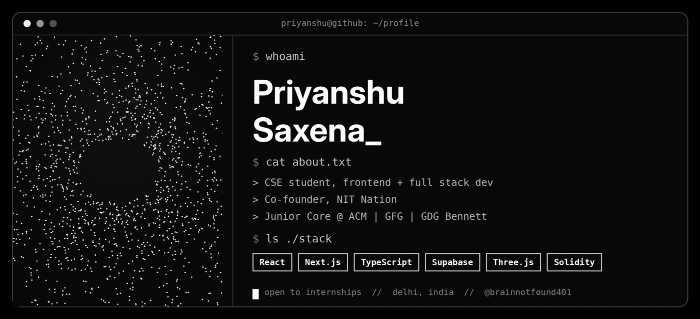

<p align="center">
  
</p>

<p align="center">
  
</p>

<p align="center">
  <a href="https://github.com/brainnotfound401?tab=followers"></a>
  
  <a href="https://www.linkedin.com/in/priyanshu-saxena-0a29a925b/"></a>
  <a href="https://www.instagram.com/priyanshu_saxena2008/"></a>
</p>

---

```bash
$ cat about.txt
> Name      : Priyanshu Saxena
> Role      : #FrontendDeveloper  (and full stack when needed)
> Studying  : B.Tech Computer Science
> Teams     : Junior Core Technical Team @ ACM, GeeksforGeeks & GDG, Bennett University
> Founder   : Co-founder of NIT Nation
> Status    : Open to internships and hackathon teams
```

### `$ ls ./stack`

<p align="center">
  
</p>

### `$ ls ./projects --pinned`

<p align="center">
  <a href="https://github.com/brainnotfound401/blockchain"></a>
  <a href="https://github.com/brainnotfound401/kairos"></a>
</p>
<p align="center">
  <a href="https://github.com/brainnotfound401/Nitnation"></a>
  <a href="https://github.com/brainnotfound401/easy-eyes"></a>
</p>
<p align="center">
  <a href="https://github.com/brainnotfound401/assemble-26"></a>
  <a href="https://github.com/brainnotfound401/KisanSetu"></a>
</p>

### `$ ./dino --run`

<p align="center">
  <a href="https://brainnotfound401.github.io/brainnotfound401/dino-game.html">
    
  </a>
</p>
<p align="center"><b><a href="https://brainnotfound401.github.io/brainnotfound401/dino-game.html">&#9654; Play the game</a></b></p>

### `$ git log --stats`

<p align="center">
  
  
</p>

<p align="center">
  
</p>

<p align="center">
  
</p>

<p align="center">
  
</p>

<p align="center"><code>$ exit 0  //  thanks for visiting</code></p>
